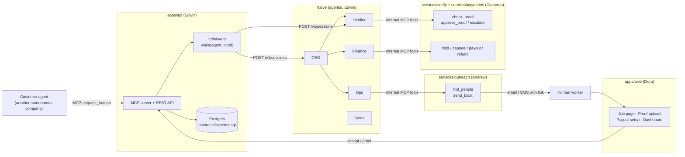
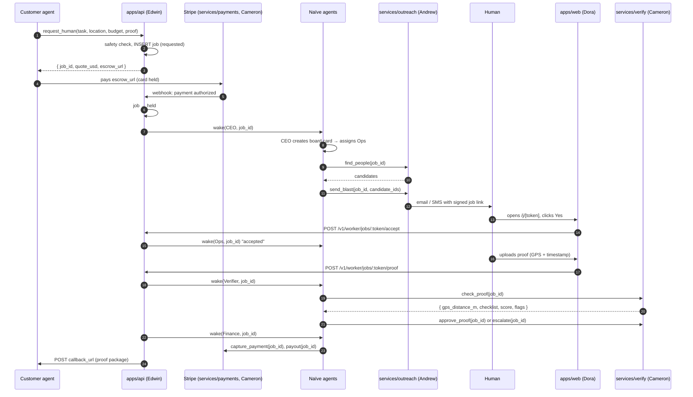
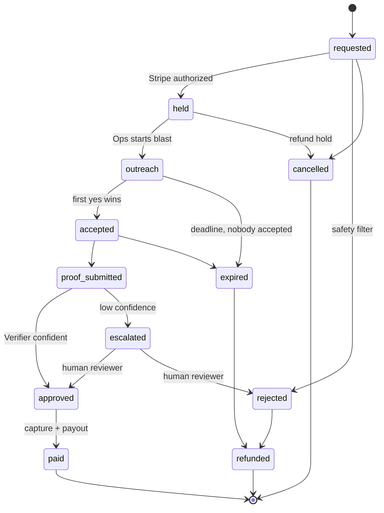
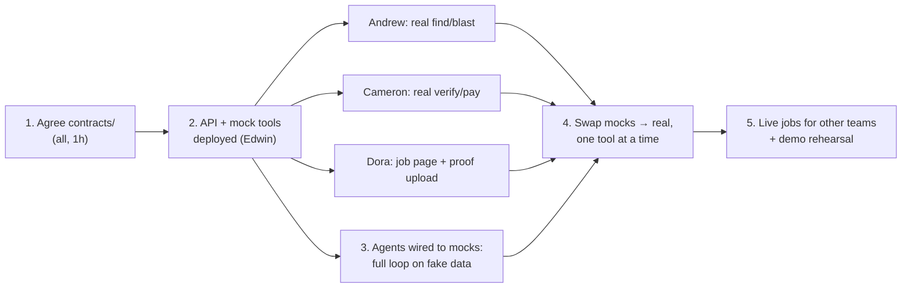

# Operis: the full flow

This document follows one job from request to payout. At each step it shows who owns the step, which folder the code lives in, and which Naïve agent wakes up. When you're unsure where an edit goes, look here first.

- **Shared contract:** [`contracts/`](../contracts). This is the only place where everyone's code meets.
- **Team split:** see the [README](../README.md#team-split).
- **Build plans:** [Edwin: API, MCP, database, agents](plans/edwin.md)

---

## 1. The big picture



**The rule:** agents decide, tools do the work. Agents never touch Stripe, Twilio or the database directly. They call internal MCP tools, and the services behind those tools are where the real logic lives.

---

## 2. One job, step by step

| # | Step | What happens | Owner | Code lives in | Job status after | Wakes |
|---|------|--------------|-------|---------------|------------------|-------|
| 1 | **Request** | Customer agent calls `request_human` | Edwin | `apps/api/src/mcp/public.ts` | `requested` | none |
| 2 | **Safety check** | Abuse filter rejects or flags the request; borderline cases → founder | Edwin | `apps/api/src/lib/safety.ts` | `requested` or `rejected` | none |
| 3 | **Hold payment** | Stripe Checkout with manual capture; the API returns `escrow_url` | Cameron | `services/payments/` | `held` (after the Stripe webhook) | **CEO** |
| 4 | **Plan** | CEO puts a card on the board and assigns it to Ops | Edwin (prompt) | `agents/prompts/ceo.md` | `held` | **Ops** (via the board) |
| 5 | **Find people** | Ops calls `find_people(job_id)` → ranked candidates from public sources | Andrew | `services/outreach/find.ts` | `outreach` | none |
| 6 | **Reach out** | Ops calls `send_blast(job_id, candidate_ids)` → email/SMS with a signed job link | Andrew | `services/outreach/blast.ts` | `outreach` | none |
| 7 | **Job page** | The human opens the link and sees the task, pay and location; clicks Yes or No | Dora | `apps/web/` → `/j/[token]` | `accepted` (first yes wins) | **Ops** |
| 8 | **Do the job + proof** | The human uploads photos, video or files with GPS and a timestamp | Dora (UI), Edwin (endpoint) | `apps/web/` → `/j/[token]/proof`, `apps/api/src/routes/proof.ts` | `proof_submitted` | **Verifier** |
| 9 | **Verify** | Verifier calls `check_proof` → evidence; then decides `approve_proof` or `escalate` | Cameron (tools), Edwin (prompt) | `services/verify/`, `agents/prompts/verifier.md` | `approved` / `escalated` / `rejected` | **Finance** (if approved) |
| 10 | **Charge + pay** | Finance calls `capture_payment` then `payout`; the worker sets up a bank account on their first payout | Cameron (tools), Dora (payout screen) | `services/payments/`, `apps/web/` → `/payout` | `paid` | none |
| 11 | **Report back** | The API calls the customer's `callback_url`; `get_job` returns the proof package | Edwin | `apps/api/src/lib/callbacks.ts` | `paid` | none |
| 12 | **Book it** | CEO closes the card and books the margin; the daily report runs on a cron schedule | Edwin | `agents/prompts/ceo.md`, `agents/agents.json` | none | **CEO** (cron) |

---

## 3. Sequence: who talks to whom



---

## 4. Job states

The source of truth is [`contracts/states.ts`](../contracts/states.ts). The arrows below are the only allowed transitions; the API rejects anything else.



---

## 5. What wakes which agent

All wake-ups go through **one helper**, `apps/api/src/lib/naive.ts → wake(agent, jobId, message)`, which calls Naïve `POST /v1/sessions`. Don't call Naïve from anywhere else.

| Event (arrives at the API) | Wakes | Message |
|---|---|---|
| Stripe: payment authorized | **CEO** | `Job {id} is funded. Plan it and assign it.` |
| Worker clicked Yes | **Ops** | `Job {id} accepted by worker {wid}. Confirm and stop outreach.` |
| Nobody accepted within N minutes | **Ops** | `Job {id} has no taker. Widen the search or escalate.` |
| Proof uploaded | **Verifier** | `Job {id} has a new proof. Check it.` |
| Proof approved | **Finance** | `Job {id} approved. Capture and pay out.` |
| Email arrives at ops@ or sales@ | Ops or Sales | *(Naïve handles this itself via identities)* |
| Daily at 08:00 PT | **CEO** | *(Naïve cron deployment)* |

**Rules for `wake()`:**
- Pass the **job ID, not job data**. The agent reads fresh data with `get_job`.
- Respond to the HTTP caller first, then wake the agent.
- Store `naive_session_id` on the job, and send follow-ups to the same session when possible.
- Make wake-ups idempotent, keyed on `(job_id, event)`, because webhooks retry.

---

## 6. Where your edits go

```
.
├── contracts/                 ← SHARED. Change only after the team agrees.
│   ├── states.ts                job states + allowed transitions
│   ├── tools.ts                 every MCP tool: name, input, output, owner
│   └── schema.sql               Postgres tables
│
├── apps/
│   ├── api/                   ← EDWIN
│   │   └── src/
│   │       ├── mcp/public.ts      request_human, get_job, cancel_job (customers)
│   │       ├── mcp/internal.ts    registers tools from services/* (our agents)
│   │       ├── routes/            REST: jobs, worker accept/decline, proof upload
│   │       ├── webhooks/          stripe.ts, twilio.ts
│   │       └── lib/               naive.ts (wake), safety.ts, callbacks.ts, db.ts
│   └── web/                   ← DORA
│       ├── /j/[token]             job page: Yes / No, certification upload
│       ├── /j/[token]/proof       proof upload with GPS
│       ├── /payout                bank setup (Stripe Connect link)
│       └── /dashboard             map, live job, agent feed, money
│
├── services/
│   ├── outreach/              ← ANDREW   find_people, send_blast, opt-outs, regulars
│   ├── verify/                ← CAMERON  check_proof, approve_proof, escalate
│   └── payments/              ← CAMERON  hold, capture, payout, refund, ledger
│
├── agents/                    ← EDWIN
│   ├── agents.json              5 agents: model, budget, tools allowed/ask/deny
│   ├── prompts/*.md             system prompt per agent
│   └── skills/                  Naïve skills (tool owners write the "how to use my tool" part)
│
├── scripts/smoke.ts           ← EVERYONE  calls every tool once; run before demo
└── docs/FLOW.md               ← this file
```

**How a service becomes an agent tool:**

1. The owner implements the function in `services/<area>/`, matching its entry in `contracts/tools.ts`.
2. Edwin registers it in `apps/api/src/mcp/internal.ts`. Every tool starts as a mock that returns contract-shaped fake data, so agents work from hour one.
3. Edwin allows it on the right agent in `agents/agents.json`.
4. The owner adds a call to `scripts/smoke.ts`.

---

## 7. Who owns which tool

| Tool | Called by | Owner | Folder | Naïve permission |
|---|---|---|---|---|
| `request_human` / `get_job` / `cancel_job` | Customer agents | Edwin | `apps/api/src/mcp/public.ts` | public |
| `get_job`, `list_jobs` | All our agents | Edwin | `apps/api` | allow |
| `find_people` | Ops | Andrew | `services/outreach` | allow |
| `send_blast` | Ops | Andrew | `services/outreach` | allow |
| `check_proof` | Verifier | Cameron | `services/verify` | allow |
| `approve_proof` | Verifier | Cameron | `services/verify` | allow (API enforces confidence ≥ 0.85 + geofence) |
| `escalate` | Verifier | Cameron | `services/verify` | allow |
| `capture_payment` | Finance | Cameron | `services/payments` | allow |
| `payout` | Finance | Cameron | `services/payments` | allow ≤ $150, **ask** above |
| `refund` | Finance, CEO | Cameron | `services/payments` | **ask** |
| `ledger` | Finance, CEO | Cameron | `services/payments` | allow |

Numeric limits (geofence, $150 cap, confidence) are enforced **in the service code**, not just in prompts. Naïve permissions apply per tool, not per amount.

---

## 8. Build order (mocks first)



**Milestone 1:** a fake job goes from `requested` to `paid` with all tools mocked.
**Milestone 2:** the same job with real tools and a real human.
