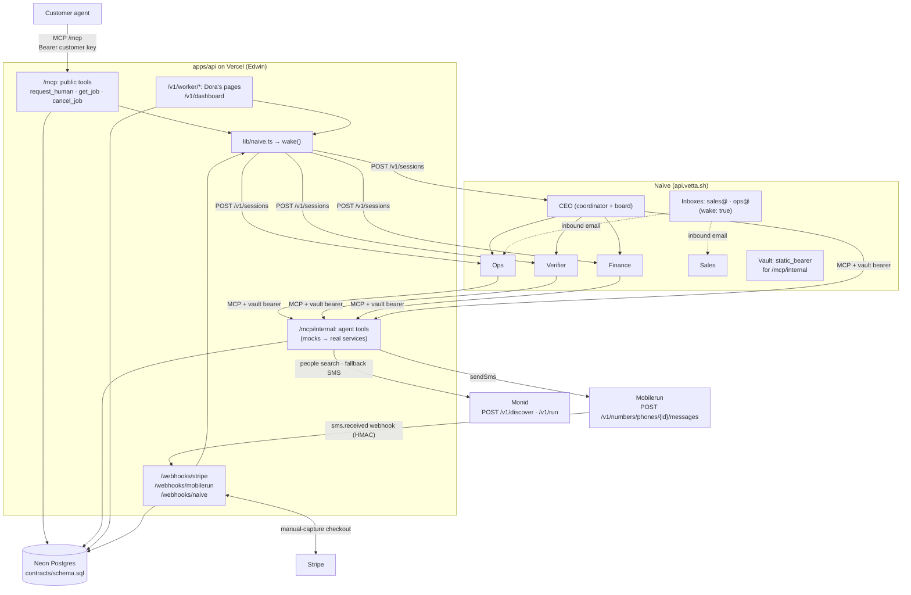

# Edwin's build plan: API, MCP server, database, Naïve agents

**Owner:** Edwin · **Stack:** Neon (Postgres) · Vercel (Next.js route handlers) · Naïve Managed Agents · Mobilerun (SMS) · Monid (people search + SMS fallback)
**Read with:** [FLOW.md](../FLOW.md) · [contracts/](../../contracts)

> Edwin builds the hub that every other part plugs into. **The fastest path is mocks first:** get a fake job from `requested` to `paid` through real Naïve agents with every tool faked. Then the team swaps real tools in one at a time.

---

## 0. Definition of done

| Milestone | What it proves | Target | Human check |
|---|---|---|---|
| **M0: Spikes pass** | Naïve can call our MCP server with auth; a Mobilerun number can send and receive SMS; the Monid key works | Sat +1.5h | [§8 M0](#m0-spikes-pass) |
| **M1: Loop on mocks** | `request_human` → CEO → Ops → Verifier → Finance → `paid`, every tool mocked, no human touching anything | Sat +5h | [§8 M1](#m1-full-loop-on-mocks) |
| **M2: Loop on real tools** | Same loop with Andrew's, Cameron's and Dora's real parts, and one real human | Sat evening | [§8 M2](#m2-full-loop-on-real-tools-with-a-real-human) |
| **M3: Running for others** | Other teams' agents calling `request_human`; ledger filling; daily report | Sun morning | [§8 M3](#m3-running-for-other-teams) |

**A milestone is done only when a human has gone through its §8 checklist and every box is ticked.** "The code ran" doesn't count.

---

## 1. What Edwin owns, and the boundaries with everyone else

**Edwin owns:** `apps/api` (MCP server, REST, webhooks), the Neon database, the `wake()` helper, the 5 Naïve agents (prompts, budgets, permissions, team, identities, vault, cron), the safety filter, customer callbacks, and the shared clients for Mobilerun and Monid.

**Edwin doesn't own:** the logic inside `find_people` / `send_blast` (Andrew), `check_proof` / payments (Cameron), or the pages (Dora). Edwin hosts their tools and gives them working mocks on day one.

### Interfaces: what Edwin gives, what Edwin needs

| Teammate | Edwin **gives** them (and when) | Edwin **needs** from them (and when) |
|---|---|---|
| **Andrew** (outreach) | `lib/mobilerun.ts` → `sendSms(to, body)`; `lib/monid.ts` → `monidRun(provider, endpoint, input)`; DB access; `POST /webhooks/mobilerun` already parsing inbound SMS → +2h | Real `find_people` and `send_blast` matching `contracts/tools.ts` → by M2 |
| **Cameron** (verify + pay) | Proof rows in DB with media URLs and GPS; Stripe webhook route that moves the job to `held` → +3h | Real `check_proof`, `approve_proof`, `escalate`, `capture_payment`, `payout`, `refund`, `ledger` → by M2 |
| **Dora** (web) | Worker REST endpoints (live with mock data) + `GET /v1/dashboard` feed → +2.5h | Job page, proof upload (keeps GPS/EXIF), `/payout`, `/dashboard` → by M2 |

**Team syncs (10 min each):** at +0 (agree contracts), +2.5h (mocks live; everyone points at the deployed API), +5h (M1 demo to the team), evening (M2).

---

## 2. Architecture with our chosen vendors



### Vendor roles, with fallbacks

| Need | Primary | Fallback 1 | Fallback 2 |
|---|---|---|---|
| Outbound SMS to workers | **Mobilerun** number | **Monid → AgentLine** `/send-messages` ($0.02/SMS, $2/month number) | Naïve `identities_send_sms` |
| Inbound SMS ("YES 4821") | **Mobilerun** `sms.received` webhook | Monid AgentLine `/list-messages` (poll) | Job page link only (Dora) |
| Find people | **Monid** (`/v1/discover` → `/v1/run`, e.g. LinkedIn, Reddit, maps search) | Seeded regulars list | n/a |
| Voice call to a worker who has gone quiet (stretch) | **Monid → AgentLine** `/place-calls` | n/a | n/a |
| Email | **Naïve identities** (sales@, ops@) | n/a | n/a |
| Database | **Neon** (`@neondatabase/serverless`) | n/a | n/a |

`lib/messaging.ts` hides the choice: `sendSms()` tries Mobilerun, falls back to Monid AgentLine, and writes a `ledger` row (`sms_cost`). Andrew calls only `sendSms()`.

---

## 3. Accounts and keys checklist (Phase 0, before writing code)

| Service | Action | Env var(s) | Who |
|---|---|---|---|
| Naïve | **Rotate the key that was pasted into chat.** Create a new key; keep `admin` only on Edwin's personal key | `NAIVE_API_KEY` | Edwin |
| Naïve | Invite teammates: `POST /v1/organizations/{org}/members` (`member` role) | n/a | Edwin |
| Neon | New project → copy the **pooled** connection string; run `contracts/schema.sql` | `DATABASE_URL` | Edwin |
| Vercel | New project from `apps/api`; connect Neon via the Vercel integration | n/a | Edwin |
| Mobilerun | Sign up, create an API key (`dr_sk_…`), buy a US number, register the webhook | `MOBILERUN_API_KEY`, `MOBILERUN_PHONE_ID`, `MOBILERUN_WEBHOOK_SECRET` | Edwin |
| Monid | Sign up ($1 free credit), create an API key (`monid_live_…`), redeem any hackathon promo code | `MONID_API_KEY` | Edwin, shared with Andrew |
| Stripe | Test mode; Checkout + Connect enabled | `STRIPE_SECRET_KEY`, `STRIPE_WEBHOOK_SECRET` | Cameron creates, Edwin stores |
| Ours | Generate random secrets | `INTERNAL_MCP_KEY`, `LINK_SIGNING_SECRET`, `NAIVE_WEBHOOK_SECRET` | Edwin |

**Full env list (Vercel):** `DATABASE_URL`, `NAIVE_API_KEY`, `NAIVE_AGENT_CEO`, `NAIVE_AGENT_OPS`, `NAIVE_AGENT_VERIFIER`, `NAIVE_AGENT_FINANCE`, `NAIVE_AGENT_SALES`, `INTERNAL_MCP_KEY`, `MOBILERUN_API_KEY`, `MOBILERUN_PHONE_ID`, `MOBILERUN_WEBHOOK_SECRET`, `MONID_API_KEY`, `STRIPE_SECRET_KEY`, `STRIPE_WEBHOOK_SECRET`, `LINK_SIGNING_SECRET`, `PUBLIC_BASE_URL`, `GEOFENCE_LAT`, `GEOFENCE_LNG`, `GEOFENCE_RADIUS_M`, `USE_MOCKS`.

---

## 4. Step-by-step build

Each phase ends with a **check** that must pass before moving on.

### Phase 0: Spikes that remove the biggest unknowns (≈ 1.5h)

Do these first. Each one could force a design change, so it's cheaper to learn now.

**Spike A: can Naïve agents call our MCP server with auth?** (the critical one)
1. Deploy a tiny Vercel route `/mcp/internal` exposing one tool, `ping`, that checks `Authorization: Bearer $INTERNAL_MCP_KEY`.
2. Create a vault and a `static_bearer` credential bound to our host:
   ```http
   POST https://api.vetta.sh/v1/vaults            { "display_name": "operis" }
   POST https://api.vetta.sh/v1/vaults/{id}/credentials
        { "kind": "static_bearer", "key": "operis-internal",
          "host": "<our>.vercel.app", "value": "<INTERNAL_MCP_KEY>" }
   ```
3. Create an `ops-dev` agent with `mcp_servers: [{ name: "operis", url: "https://<our>.vercel.app/mcp/internal" }]` and `tools.configs["operis.ping"] = { permission: "allow" }`.
4. `POST /v1/sessions { agent_id, message: "Call ping and tell me the result." }`, then read `GET /v1/sessions/{id}/events`.
- **Check:** the agent called `ping` and our server saw the bearer. *If the vault doesn't attach it:* try the `headers` field on `mcp_servers` (the schema allows it, but our earlier notes say inline auth headers may be rejected). *Last resort:* put a secret path segment in the URL (`/mcp/internal/<key>`).

**Spike B: can a Mobilerun number send and receive SMS?**
1. `POST https://api.mobilerun.ai/v1/numbers/phones` (US) → poll `GET /v1/numbers/phones/{id}` until active.
2. `POST /v1/numbers/phones/{id}/messages` to a teammate's phone.
3. Register a webhook (`POST /v1/webhooks`, events `sms.received`, `sms.send.failed`) to `/webhooks/mobilerun`; reply from the phone.
- **Check:** the SMS arrives, and the reply reaches our webhook with a valid `X-Mobilerun-Signature`.
- **Watch for:** their docs describe `sms.received` as "for a device's number", so a number may need a cloud device attached. They also return `429 daily_limit_reached`. *If either blocks us:* switch `lib/messaging.ts` to Monid AgentLine and keep going. Don't spend more than 30 minutes here.

**Spike C: Monid works**
- `POST https://api.monid.ai/v1/discover { "query": "find people on linkedin by job title and city" }` → `POST /v1/inspect` → `POST /v1/run` with a tiny input.
- **Check:** we get results and the cost is visible. Hand the key and the working provider/endpoint IDs to Andrew.

**Model check:** list models and pick one that supports vision for the Verifier. The catalog on our account includes `anthropic/claude-haiku-5.5`, `openai/gpt-6-luna` and `google/gemini-2.5-flash-lite`. Use the same model for all five agents at first, and swap later.

### Phase 1: Database and API skeleton (≈ 1h)

```
apps/api/src/        (Next.js with a src/ dir, to match FLOW.md and Andrew's plan)
├── app/
│   ├── mcp/route.ts                 public MCP (customer key)
│   ├── mcp/internal/route.ts        internal MCP (INTERNAL_MCP_KEY)
│   ├── v1/worker/jobs/[token]/route.ts          GET job for page
│   ├── v1/worker/jobs/[token]/accept/route.ts   POST
│   ├── v1/worker/jobs/[token]/decline/route.ts  POST
│   ├── v1/worker/jobs/[token]/proof/route.ts    POST (multipart → Blob → proofs row)
│   ├── v1/worker/payout-setup/route.ts          POST → Cameron's Connect link
│   ├── v1/dashboard/route.ts                    GET (jobs, agent feed, money)
│   ├── webhooks/stripe/route.ts
│   ├── webhooks/mobilerun/route.ts
│   └── webhooks/naive/route.ts                  session.idle, tool.confirm, budget.exceeded
├── lib/
│   ├── db.ts            neon() client + transitionJob(jobId, to) using canTransition()
│   ├── naive.ts         wake()
│   ├── messaging.ts     sendSms() → Mobilerun, fallback Monid AgentLine
│   ├── mobilerun.ts     REST client + verifySignature()
│   ├── monid.ts         discover/inspect/run client
│   ├── links.ts         signed worker tokens (HMAC)
│   ├── safety.ts        abuse filter
│   └── callbacks.ts     POST customer callback_url
└── tools/
    ├── registry.ts      maps tool name → mock | real implementation (USE_MOCKS)
    └── mocks.ts         contract-shaped fake responses for every tool
```

1. `npx create-next-app apps/api --ts --app --src-dir --no-tailwind` (route handlers only).
2. Neon: run `contracts/schema.sql`. Add `lib/db.ts` with `transitionJob()`, which **refuses** any move `canTransition()` doesn't allow and writes `updated_at`.
3. Deploy to Vercel and set `PUBLIC_BASE_URL`.
- **Check:** `GET /api/health` returns DB OK from the deployed URL.

### Phase 2: MCP servers with mocks (≈ 1.5h)

- Use Vercel's `mcp-handler` package (streamable HTTP) or `@modelcontextprotocol/sdk` directly. Register tools from `contracts/tools.ts` with zod schemas.
- **Public `/mcp`:** `request_human` (validate → `safety.ts` → insert job → create Stripe checkout via Cameron's function, mocked for now → return `{job_id, quote_usd, escrow_url}`), `get_job`, `cancel_job`. Auth: a customer API key (hashed in `customers`). For the hackathon, hand out keys manually.
- **Internal `/mcp/internal`:** every agent tool, routed through `tools/registry.ts`. With `USE_MOCKS=true`, tools return `mocks.ts` data, **and the mocks move the job state** (e.g. mock `approve_proof` moves the job to `approved`), so the loop really runs.
- Keep every tool result short. Naïve truncates tool results at 8,000 characters.
- **Mock shortcut:** in mock mode, `request_human` immediately moves the job to `held` and wakes the CEO, skipping Stripe.
- **Check:** `scripts/smoke.ts` calls all 12 tools against the deployed API and they all return contract-shaped data.

### Phase 3: Wake-ups, webhooks, worker endpoints (≈ 1h)

**`lib/naive.ts`: the only code that calls Naïve:**
```ts
const AGENTS = { ceo: process.env.NAIVE_AGENT_CEO!, ops: process.env.NAIVE_AGENT_OPS!,
  verifier: process.env.NAIVE_AGENT_VERIFIER!, finance: process.env.NAIVE_AGENT_FINANCE! };

export async function wake(agent: keyof typeof AGENTS, jobId: string, event: string, message: string) {
  // idempotent: one wake per (job, event)
  const inserted = await sql`insert into wake_events (job_id, event) values (${jobId}, ${event})
                             on conflict do nothing returning job_id`;
  if (inserted.length === 0) return;
  const res = await fetch("https://api.vetta.sh/v1/sessions", {
    method: "POST",
    headers: { Authorization: `Bearer ${process.env.NAIVE_API_KEY}`, "Content-Type": "application/json" },
    body: JSON.stringify({ agent_id: AGENTS[agent], message, metadata: { job_id: jobId, event },
                           budget_micro_usd: 2_000_000 }),
  });
  const s = await res.json();
  await sql`update wake_events set naive_session_id = ${s.id} where job_id = ${jobId} and event = ${event}`;
}
```
Call it **after** responding: in Next.js use `after(() => wake(...))` from `next/server` (or `waitUntil` from `@vercel/functions`).

**Event → wake map** (matches `WAKE_ON_ENTER` in `contracts/states.ts`):

| Trigger | Route | State change | Wake |
|---|---|---|---|
| Stripe `checkout.session.completed` (manual capture authorized) | `/webhooks/stripe` | → `held` | CEO |
| Worker clicks Yes **or** texts `YES 4821` | `/v1/worker/.../accept` or `/webhooks/mobilerun` | → `accepted` (first wins: `update … where status='outreach'`) | Ops |
| Proof uploaded | `/v1/worker/.../proof` | → `proof_submitted` | Verifier |
| `approve_proof` succeeds | inside the tool | → `approved` | Finance |
| `payout` succeeds | inside the tool | → `paid` → `callbacks.ts` | none |
| Naïve `tool.confirm` (an agent is waiting on an `ask` approval) | `/webhooks/naive` | none | alert a founder |

**`/webhooks/mobilerun`:** verify HMAC-SHA256 over `"{X-Mobilerun-Timestamp}.{rawBody}"` with `MOBILERUN_WEBHOOK_SECRET`, reject stale timestamps, dedupe on `id`, return 200 fast. Parse `YES <code>` / `NO <code>` / `STOP`. `STOP` sets `workers.opted_out = true` (a legal requirement for SMS).

**Check:** POSTing a fake Stripe event moves the job to `held` and a CEO session appears in Naïve.

### Phase 4: Create the Naïve company (≈ 1.5h)

Write **`agents/setup.ts`**, an idempotent script that creates or updates everything from `agents/agents.json` using the REST API. That's reproducible, it goes in the repo, and anyone can rerun it.

1. **Four members** (`POST /v1/agents`), each with:
   - `model`, `harness: "pi"` (GA; supports approvals and structured output), `system` from `agents/prompts/*.md`
   - `budget: { cap_micro_usd, max_task_micro_usd, period: "day" }`. Demo values: Ops $40/$5, Verifier $40/$3, Finance $20/$5, Sales $20/$5
   - `mcp_servers: [{ name: "operis", url: "https://<our>.vercel.app/mcp/internal" }]`
   - `tools: { default_config: { permission: "deny" }, configs: { … only its own tools … } }` (matches `calledBy` in `contracts/tools.ts`; `refund` and large payouts are `ask`)
   - Verifier: `output_schema: { decision, confidence, reasons }` + `structured_output_required: true`
2. **CEO** (`POST /v1/agents`) with `budget` $300/$25 per day and
   ```json
   "multiagent": { "type": "coordinator", "board": true,
     "agents": [ { "type": "agent", "id": "<ops>",      "version": 1 },
                 { "type": "agent", "id": "<verifier>", "version": 1 },
                 { "type": "agent", "id": "<finance>",  "version": 1 },
                 { "type": "agent", "id": "<sales>",    "version": 1 } ] }
   ```
   Pinned versions mean teammates can edit prompts without breaking the running team. Raise the pin when a version is ready.
3. **Vault credential** for `/mcp/internal` (from Spike A).
4. **Identities and inboxes:** `POST /v1/identities` ("Operis Sales", "Operis Ops") → `POST /v1/identities/{id}/emails { owning_agent_id, wake: true }`, so inbound email wakes Sales or Ops. Attach with `POST /v1/agents/{id}/identities`.
5. **Daily report:** `POST /v1/deployments { agent_id: <ceo>, cron: "0 8 * * *", timezone: "America/Los_Angeles", input_template: "Write the daily report from the ledger…", budget_micro_usd: 1_000_000 }`.
6. **Webhook to us:** `POST /v1/webhooks { url: ".../webhooks/naive", events: ["session.idle","tool.confirm","budget.exceeded"] }`.
7. **Notifications:** set `notifications: { email: <founder>, approvals: true }` on the CEO and Finance, so `ask` approvals reach a founder's inbox.

**Prompt rules (all agents):** "Read the job with `get_job` first. Never guess IDs. Report back on the board card. Stay within your limits; if a tool returns an error, don't retry blindly; escalate on the card."

**Check:** create a job with `request_human` (mock mode) and watch the CEO create a card, Ops run `find_people` → `send_blast`, then the loop stall at `outreach`. That's expected; next, simulate the worker.

### 🎯 Milestone 1 (≈ +5h): the full loop on mocks

`scripts/simulate.ts` plays the human: it calls accept, then uploads a sample proof photo with GPS. Expected trace: `requested → held → outreach → accepted → proof_submitted → approved → paid`, with CEO, Ops, Verifier and Finance sessions visible in Naïve and the board card closed. **Demo it to the team.**

### Phase 5: Swap in the real tools (Saturday evening)

- Flip tools one at a time in `tools/registry.ts` (per-tool override such as `REAL_TOOLS=find_people,send_blast`), run `smoke.ts` after each, and keep the mock for a fast rollback on stage.
- **Safety filter (`lib/safety.ts`):** one cheap model call on title + instructions that returns `allow | reject(reason) | elevated`. Reject: identity proxy (CAPTCHA, OTP, accounts, posing as someone), handling others' credentials or IDs, surveillance or private property, licensed or dangerous work, signing anything. `elevated` → `ask` a founder.
- **Geofence and limits in code:** `request_human` rejects jobs outside `GEOFENCE_RADIUS_M`; Cameron's `approve_proof` and `payout` enforce their thresholds.
- **Callbacks:** on `paid`, POST the proof package to the customer's `callback_url` (signed).

### Phase 6: Demo hardening (Sunday)

- `GET /v1/dashboard` for Dora: active job + state timeline, last 20 agent events (from the `/webhooks/naive` log), ledger totals, map points.
- **Seed** 3–5 regulars (teammates and friends) so first-yes is fast on stage.
- **Customer kit for other teams:** a one-paragraph README with the MCP URL, a key and an example `request_human` call. Sales emails it from sales@.
- **Kill switches:** `USE_MOCKS` per tool; `PAUSE_OUTREACH=true` stops outbound SMS.
- Rehearse with `simulate.ts` twice; then once with a real human.

---

## 5. Contract changes to propose to the team

These need agreement because they touch shared files:

1. **`outreach.short_code text`**: a 4-digit code per outreach, so workers can reply `YES 4821` by SMS (Mobilerun inbound) as well as clicking the link.
2. **`messaging_events` table**: inbound and outbound SMS log for the dashboard and debugging (Mobilerun event `id` as the dedupe key).
3. **`sendSms()` lives in `apps/api/src/lib/messaging.ts`** (Edwin), and Andrew's `send_blast` calls it. That keeps the vendor choice and fallbacks in one place.
4. **`agent_events` table**: Naïve webhook events, feeding Dora's agent feed.

---

## 6. Risks and fallbacks

| Risk | Likelihood | Fallback |
|---|---|---|
| Naïve won't send our bearer to the MCP server | Medium | `headers` on `mcp_servers` → secret URL path |
| Mobilerun number needs a device, or hits limits | Medium | `lib/messaging.ts` → Monid AgentLine (switch with an env flag) |
| Agents loop or burn budget | Medium | Per-session `budget_micro_usd`, per-agent caps, `default_config: deny`, short tool outputs |
| Coordinator delegation is slow on stage | Medium | Wake Ops directly on `held` (one-line change in `WAKE_ON_ENTER`); keep the CEO for the board and P&L |
| Stripe Connect onboarding too slow for a new worker | High | Demo workers onboarded Saturday night; new workers get "payout pending" |
| Vision model misjudges proof | Medium | Cameron's `check_proof` does GPS and EXIF checks in code; low confidence → `escalate` |
| Webhooks retry and double-wake | High | `wake_events` primary key; dedupe on vendor event IDs |

---

## 7. Order of work (Edwin's checklist)

- [ ] Rotate the Naïve key; invite teammates
- [ ] Neon project + schema; Vercel project; env vars
- [ ] **Spike A** (Naïve → MCP auth) · **Spike B** (Mobilerun SMS round trip) · **Spike C** (Monid run)
- [ ] `lib/db.ts` with `transitionJob()`; health route deployed
- [ ] `/mcp` public + `/mcp/internal` with all 12 tools mocked; `scripts/smoke.ts`
- [ ] `wake()` + Stripe, Mobilerun and Naïve webhooks + worker endpoints (hand to Dora)
- [ ] `lib/messaging.ts` + `lib/monid.ts` (hand to Andrew)
- [ ] `agents/agents.json`, prompts, `agents/setup.ts`: 4 members + CEO team + vault + identities + cron + webhook
- [ ] **M1:** `scripts/simulate.ts` runs the full loop on mocks
- [ ] Safety filter, geofence, callbacks
- [ ] Swap real tools one by one → **M2**
- [ ] Dashboard feed, seeds, customer kit, kill switches → **M3** and rehearsal

---

## 8. Human milestone checks

These are for a **person** to run and look at with their own eyes before calling a milestone done. Each check says **what to do**, **where to look**, **what you should see**, and **what to do if it fails**. Tick the boxes in your copy, or paste results into the team chat.

### Setup for checking (do once)

Put these in your shell (never in chat or in the repo):
```bash
export API=https://<our>.vercel.app          # deployed apps/api
export NAIVE=https://api.vetta.sh/v1
export NAIVE_API_KEY=sk_...                  # the NEW rotated key
export CUSTOMER_KEY=...                       # a test customer key from the customers table
```

Keep four windows open:
1. **Neon SQL editor** (console.neon.tech → project → SQL Editor): the database
2. **Vercel → project → Logs**: server logs, filtered to errors
3. **Naïve**: dashboard, or `curl $NAIVE/sessions -H "Authorization: Bearer $NAIVE_API_KEY"`
4. **Your phone**: for SMS checks

**Saved SQL queries** (paste into Neon):
```sql
-- Q1: latest jobs and where they are
select id, title, status, worker_id, naive_session_id, updated_at from jobs order by created_at desc limit 5;
-- Q2: which agents were woken, in order (the job's "timeline")
select event, naive_session_id, created_at from wake_events where job_id = '<JOB_ID>' order by created_at;
-- Q3: money for one job
select kind, amount_usd, ref, created_at from ledger where job_id = '<JOB_ID>' order by created_at;
-- Q4: P&L so far
select kind, sum(amount_usd) from ledger group by kind;
-- Q5: stuck jobs (no movement in 15 min, not finished)
select id, status, updated_at from jobs
where status not in ('paid','refunded','cancelled','rejected') and updated_at < now() - interval '15 minutes';
```

**Reading an agent's session** (what it actually did):
```bash
curl -s "$NAIVE/sessions/<SESSION_ID>/events" -H "Authorization: Bearer $NAIVE_API_KEY" | jq '.data[] | {type, name: .tool.name?, at: .created_at}'
```
Look for `tool.started` / `tool.completed` events naming our tools, and a final `session.idle`. If the field names differ, read the raw output once and adjust the `jq`.

---

### M0: Spikes pass

**A. Naïve agent → our MCP server (with auth)**
- [ ] **Do:** run the `ops-dev` session from Spike A (`"Call ping and tell me the result."`).
- [ ] **Look (Vercel logs):** one request to `/mcp/internal` with **status 200**, no 401s.
- [ ] **Look (session events):** a `tool.completed` for `operis.ping`, and the agent's final message quotes the ping result.
- [ ] **Negative test:** `curl -X POST $API/mcp/internal` with **no** auth header → **401**. (Proves the endpoint isn't open to the world.)
- ❌ **If 401 from Naïve:** the vault credential didn't attach. Check its `host` matches the Vercel hostname exactly (no `https://`, no path). Then try the `headers` fallback (§4, Spike A).
- ❌ **If the agent never calls the tool:** check the tool permission is `allow` and the name matches (`operis.ping`).

**B. Mobilerun SMS round trip**
- [ ] **Do:** send a test SMS to your own phone with `sendSms()` (or the raw API call).
- [ ] **Look (your phone):** the text arrives within about 30 seconds, from the Mobilerun number.
- [ ] **Do:** reply `YES 0000` from your phone.
- [ ] **Look (Vercel logs):** `/webhooks/mobilerun` returns **200**, the signature is valid, and the logged event type is `sms.received` with your text.
- [ ] **Look (Mobilerun dashboard → Webhooks → Deliveries):** the delivery shows as successful.
- [ ] **Do:** reply `STOP` → **Look (Neon):** `select opted_out from workers where phone = '<your number>'` → `true`.
- ❌ **If no SMS:** check Mobilerun's response for `409 capability_unavailable` / `429` / `403 send_disabled`. Spend no more than 30 minutes, then set the env flag to the Monid AgentLine fallback and repeat this check.
- ❌ **If signature fails:** verify over the **raw** body (before JSON parsing) with the timestamp in milliseconds: `"{ts}.{raw}"`.

**C. Monid**
- [ ] **Do:** run discover → inspect → run with a tiny input (Spike C).
- [ ] **Look:** the result has real records (names, profiles or businesses), and the run shows a cost.
- [ ] **Look (Monid dashboard):** your balance went down by roughly that cost.
- [ ] **Hand-off:** Andrew has the key and the working `provider` + `endpoint` pair. Confirm in chat.

**D. Model**
- [ ] **Do:** run a one-off session asking the Verifier model to describe an image URL.
- [ ] **Look:** it describes the image correctly. (Proves vision works through Naïve.)

✅ **M0 passes when** A, B (or the AgentLine fallback), C and D are all ticked.

---

### M1: Full loop on mocks

Prereqs: `USE_MOCKS=true`, all 5 agents created by `agents/setup.ts`, and smoke tests passing.

**1. Smoke test**
- [ ] **Do:** `npx tsx scripts/smoke.ts`
- [ ] **Look:** **12/12 tools pass**, each with a contract-shaped response. Any red line means stop and fix it first.

**2. A customer request**
- [ ] **Do:**
  ```bash
  curl -s -X POST $API/mcp -H "Authorization: Bearer $CUSTOMER_KEY" -H "Content-Type: application/json" \
    -H "Accept: application/json, text/event-stream" \
    -d '{"jsonrpc":"2.0","id":1,"method":"tools/call","params":{"name":"request_human","arguments":{
      "title":"Photograph the YC sign","instructions":"Two photos of the sign at the entrance.",
      "location":{"address":"YC, San Francisco","lat":37.7749,"lng":-122.4194},
      "deadline":"2026-11-08T18:00:00-08:00","budget_usd":30,"certification_required":null,
      "proof":{"photos":{"min":2,"must_show":["YC sign"]},"geofence_m":150}}}}'
  ```
- [ ] **Look (response):** contains a `job_id` and `quote_usd`. Copy the `job_id`.
- [ ] **Look (Neon Q1):** the job exists and in mock mode is already **`held`**.

**3. The agents wake up and do the right thing**
- [ ] **Look (Neon Q2):** a `held` wake row with a `naive_session_id`.
- [ ] **Look (CEO session events):** the CEO called `get_job` and created a **board card** assigned to Ops. Check the board too: `curl $NAIVE/agents/$NAIVE_AGENT_CEO/board -H "Authorization: Bearer $NAIVE_API_KEY"`.
- [ ] **Look (Ops session):** `find_people` → `send_blast`, in that order. Job → **`outreach`**.

**4. Play the human**
- [ ] **Do:** `npx tsx scripts/simulate.ts <JOB_ID>` (accept, then upload a sample proof).
- [ ] **Look (Neon Q1, refresh):** the status goes through `accepted` → `proof_submitted` → `approved` → **`paid`**.
- [ ] **Look (Neon Q2):** wake rows for `held`, `accepted`, `proof_submitted`, `approved`, **each exactly once**.
- [ ] **Look (Verifier session):** `check_proof` was called, then `approve_proof`, and its structured output has `decision`, `confidence` and `reasons`.
- [ ] **Look (Finance session):** `capture_payment` → `payout`.
- [ ] **Look (board):** the card ends in **done**, with a note from each member.
- [ ] **Look (Neon Q3):** ledger rows for hold, capture, payout and fee, and **payout + fee = job price**.

**5. Guardrails behave**
- [ ] **Duplicate webhook:** re-POST the same Stripe or Mobilerun event → **no new wake row** (Q2 unchanged).
- [ ] **Illegal transition:** try to set a `paid` job back to `accepted` through the API → refused.
- [ ] **Out-of-area job:** `request_human` with a Los Angeles location → rejected with a reason.
- [ ] **Abuse filter:** `"Receive an SMS code and send it to me"` → `rejected` with a reason (identity proxy).
- [ ] **No orphans:** Neon Q5 returns **0 rows**.
- [ ] **Spend:** `curl $NAIVE/agents/<id>/spend …` for each agent → small amounts, all under their caps.

✅ **M1 passes when** a fresh job reaches `paid` with **nobody touching anything** except `simulate.ts`, and every box above is ticked. **Run it twice in a row**: the second run catches anything that only worked by luck.

---

### M2: Full loop on real tools, with a real human

Swap one tool at a time and re-run smoke after each. Then do one complete run with a teammate as the worker.

**Per-tool swap check** (repeat for each tool you switch from mock to real)
- [ ] `smoke.ts` still passes for that tool, now with **real** data (not mock values).
- [ ] Vercel logs show no errors for that tool.
- [ ] If anything is off, flip it back to the mock (env flag) and tell the owner.

**The real run** (a teammate plays the worker, outside, near the job location)
- [ ] **Do:** a customer request (as in M1 step 2) for a real nearby target, with `USE_MOCKS=false`.
- [ ] **Look (Stripe test dashboard):** a PaymentIntent that's **uncaptured** (authorized only). Job → `held`.
- [ ] **Look (Andrew's outreach):** the worker gets an **email** (from the Naïve inbox) or, if they're an opted-in regular, an **SMS**, with a working job link.
- [ ] **Do (worker):** open the link → Dora's job page shows the title, pay, location and deadline → tap **Yes**.
- [ ] **Look:** job → `accepted`, the Ops session woke, and a **second** acceptance attempt (another person or a repeat tap) is refused politely.
- [ ] **Do (worker):** take 2 photos on site and upload them on the proof page.
- [ ] **Look (Neon):** `select media, gps_lat, gps_lng, captured_at from proofs where job_id='<JOB_ID>'` has real URLs, **GPS present**, and a timestamp that's minutes old.
- [ ] **Look (Verifier session):** `check_proof` evidence shows a GPS distance under the geofence and the checklist item found. The decision is **approve**.
- [ ] **Look (Stripe):** the PaymentIntent is now **captured**, and a transfer to the worker's Connect account exists, or payout shows `needs_bank_setup` and the worker got the `/payout` link.
- [ ] **Look (customer side):** the `callback_url` received the proof package (use a webhook.site URL as the test callback), and `get_job` returns `paid` with the photo URLs.
- [ ] **Look (ledger, Q3/Q4):** numbers match Stripe.

**Failure drills** (do at least two; these become demo talking points)
- [ ] **Bad proof:** upload a photo taken far away or of the wrong subject → the Verifier **escalates** (doesn't approve), and the job → `escalated`.
- [ ] **No taker:** nobody accepts within the window → Ops is woken with "no taker" and widens the search or escalates.
- [ ] **Big refund:** ask Finance for a refund → the call **waits for founder approval** (`ask`), and the founder gets the notification email.
- [ ] **SMS fallback:** set the Mobilerun flag off → an SMS still goes out via Monid AgentLine.

✅ **M2 passes when** one real human completed one real job end to end, the money matches in Stripe, the ledger and the callback, and two failure drills behaved correctly.

---

### M3: Running for other teams

- [ ] **Customer kit works for an outsider:** a person from another team follows only the kit README and successfully calls `request_human` from their agent. You don't help.
- [ ] **Real external jobs:** Neon, `select count(*) from jobs where customer_id <> '<our test customer>'` is at least 3.
- [ ] **Inbound email wakes Sales:** an email to sales@ starts a Sales session, and the reply is sensible and within the rules (no discounts below cost).
- [ ] **Daily report:** the CEO's cron ran (`GET $NAIVE/deployments/<id>/runs`), and a founder received the report with numbers that **match Neon Q4**.
- [ ] **Dashboard:** Dora's `/dashboard` shows the live job, the agent feed and money totals, all matching Neon.
- [ ] **Budgets:** no agent has hit `budget.exceeded` (check `/webhooks/naive` log or the agent events table).
- [ ] **Health sweep:** Neon Q5 (stuck jobs) = **0**; Vercel error rate about 0 over the last hour; Mobilerun webhook health = `healthy`.
- [ ] **Hands-off hour:** for one full hour no founder touched anything except approving `ask` items, and jobs still moved. Write down the times; that's your "runs without us" proof for the judges.

✅ **M3 passes when** outside teams are using it without help, the daily report matches the database, and you have a logged hands-off hour.

---

### Pre-demo check (15 min before going on stage)

- [ ] `smoke.ts` green on production
- [ ] Neon Q5 = 0 stuck jobs; no old test jobs cluttering the dashboard (filter or archive them)
- [ ] Worker A and Worker B: phones charged, links tested, Stripe Connect done
- [ ] Mobilerun number can send (one test SMS); fallback flag ready
- [ ] Every agent's spend is well under its cap, so the demo can't trip a budget limit
- [ ] Kill switches known: `PAUSE_OUTREACH`, per-tool mock flags
- [ ] Board and dashboard open on the two screens; ledger query ready
